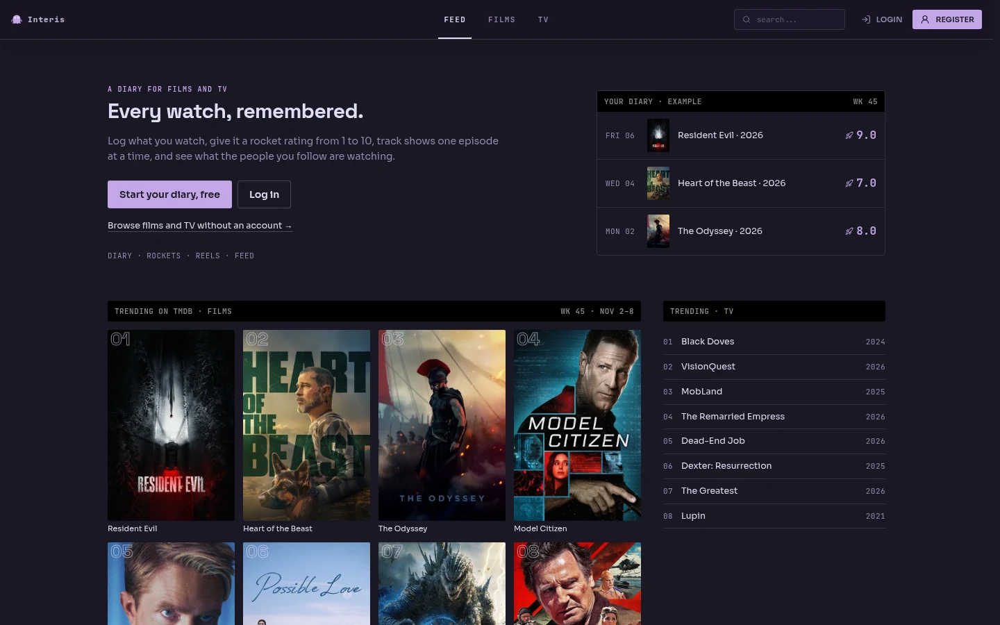
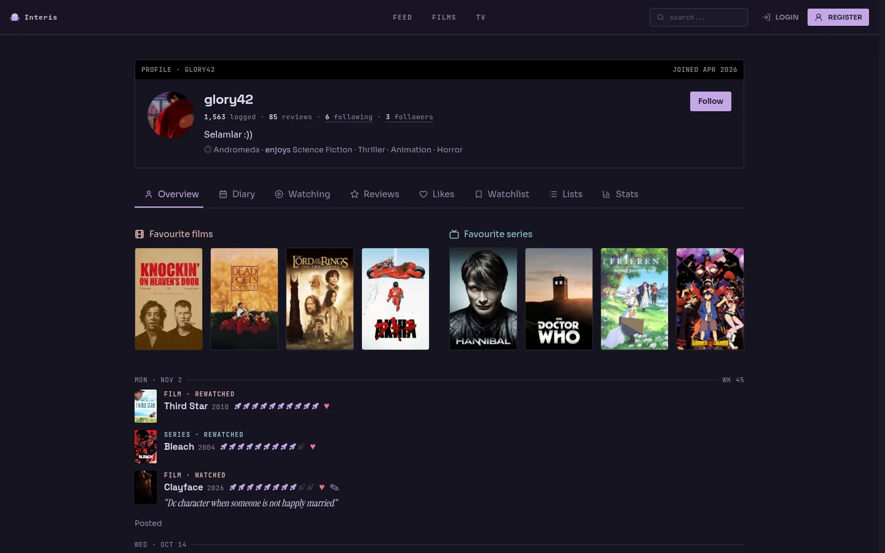
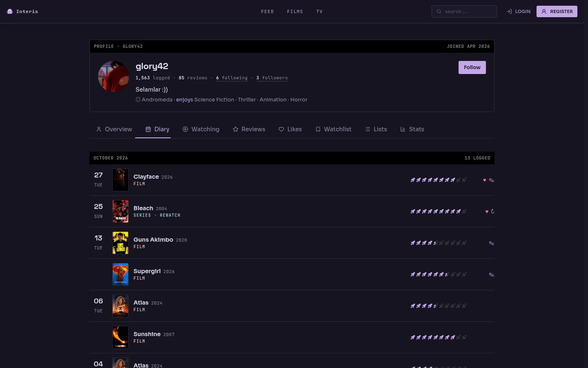
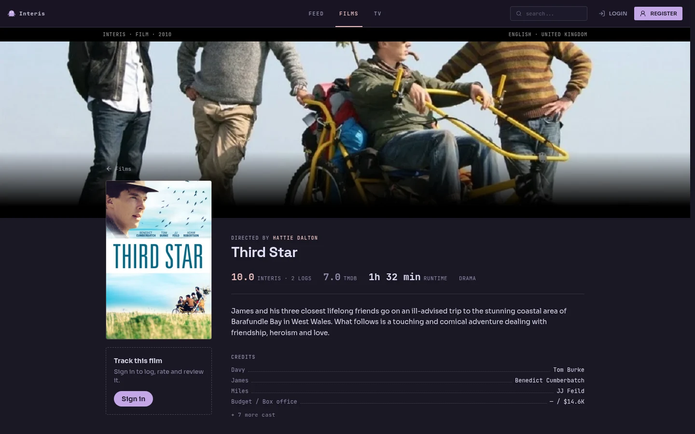
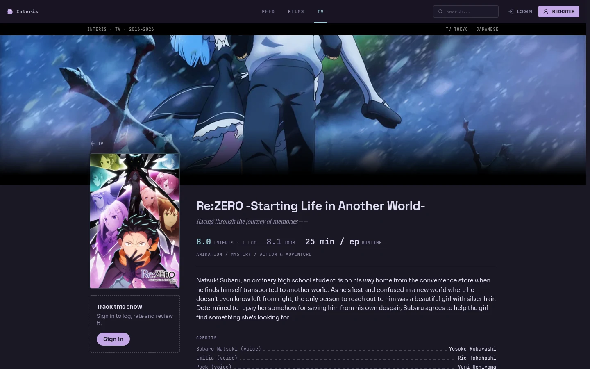
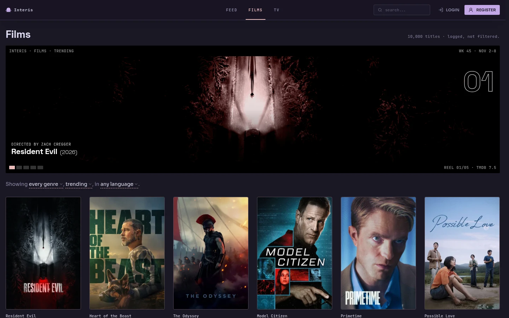
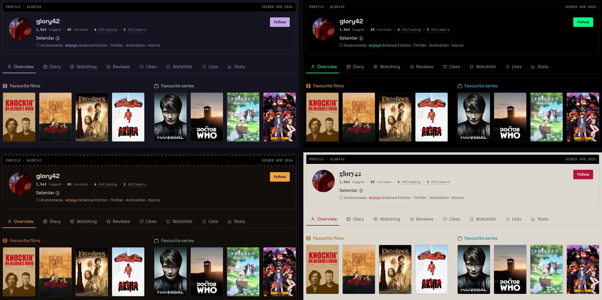

<div align="center">

# Interis

**Every watch, remembered.**

A social diary for films and TV. Log what you watch, rate it from 0.5 to 10 rockets,
track shows one episode at a time, and see what the people you follow are watching.

[**Open Interis**](https://interis.gorkemkaryol.dev) ·
[Public API docs](https://docs.interis.gorkemkaryol.dev) ·
[Contributing](CONTRIBUTING.md) ·
[Report a bug](https://github.com/Glory42/Interis/issues/new/choose)

[](https://github.com/Glory42/Interis/actions/workflows/test-suite.yml)
[](LICENSE)



</div>

## Features

- **Diary** — log films and episodes with a date, a 0.5–10 rocket rating, rewatches, likes and an optional review
- **Films & TV** — browse trending titles and an archive filtered by genre, language and sort, with director and actor pages
- **TV tracking** — follow series season by season and episode by episode
- **Social feed** — follow people and get a timeline of their logs, reviews, lists and posts
- **Profiles** — public pages with favourites, diary, reviews, likes, watchlist, lists and stats
- **Themes** — four hand-made themes, from a pure-black terminal to a cream cinema lobby
- **Public API** — read-only endpoints for embedding your diary in your own site

## Screenshots

| Profile | Diary |
| --- | --- |
|  |  |
| **Film page** | **TV page** |
|  |  |



### Themes

Rose Pine, NULL://LOG, Nitrate and Marquee — pick one in settings, or
[add your own](ADDING-THEMES.md).



## Public API

Anyone can read a user's public data, with no key, from
`https://api.interis.gorkemkaryol.dev/api/public/:username/*` — profile,
recent activity, diary, reviews, lists, likes, watchlist and top 4.

```bash
curl https://api.interis.gorkemkaryol.dev/api/public/glory42/top4
```

See the [API docs](https://docs.interis.gorkemkaryol.dev) for every endpoint,
response shapes and rate limits.

## Tech stack

| | |
| --- | --- |
| **Frontend** | React 19, Vite, TanStack Router + Query, Tailwind CSS v4, Radix/shadcn |
| **Backend** | Bun, Express 5, TypeScript, Zod, in-house JWT auth |
| **Data** | PostgreSQL (Neon) with Drizzle ORM; TMDB fetched on demand and cached |
| **Storage** | Cloudflare R2 for avatars |
| **Hosting** | Render (API), Cloudflare Pages (web + docs) |

## Running locally

With Docker installed:

```bash
git clone https://github.com/Glory42/Interis.git
cd Interis
docker compose up
```

This starts Postgres, applies migrations, and runs the API on
`http://localhost:5000` and the app on `http://localhost:5173`. Copy
[`.env.example`](.env.example) to `.env` first and add a `TMDB_ACCESS_TOKEN`
if you want real film and TV data.

For running without Docker, tests and quality checks, see
[CONTRIBUTING.md](CONTRIBUTING.md#development-setup).

## Project layout

```text
apps/
├── api/    Express API — domain modules, Drizzle schema and migrations
├── web/    React app
├── docs/   Astro + Starlight site for the public API
└── e2e/    Playwright smoke tests
```

## Documentation

| Read this | For |
| --- | --- |
| [CONTRIBUTING.md](CONTRIBUTING.md) | Setup, architecture, conventions, testing, CI |
| [apps/api/README.md](apps/api/README.md) | Backend modules, env vars, API surface |
| [apps/web/README.md](apps/web/README.md) | Frontend structure |
| [apps/docs/README.md](apps/docs/README.md) | Working on the API docs site |
| [ADDING-THEMES.md](ADDING-THEMES.md) | Adding a theme |
| [DEPLOYMENT.md](DEPLOYMENT.md) | Deploying to Render and Cloudflare Pages |
| [CONTEXT.md](CONTEXT.md) and [docs/adr](docs/adr) | Domain language and architecture decisions |

## Contributing

Issues and pull requests are welcome — start with [CONTRIBUTING.md](CONTRIBUTING.md).
By taking part you agree to the [Code of Conduct](CODE_OF_CONDUCT.md). Please report
security issues privately as described in [SECURITY.md](SECURITY.md).

## License

[GPL-3.0](LICENSE). Film and TV data and images come from [TMDB](https://www.themoviedb.org/);
Interis uses the TMDB API but is not endorsed or certified by TMDB.
